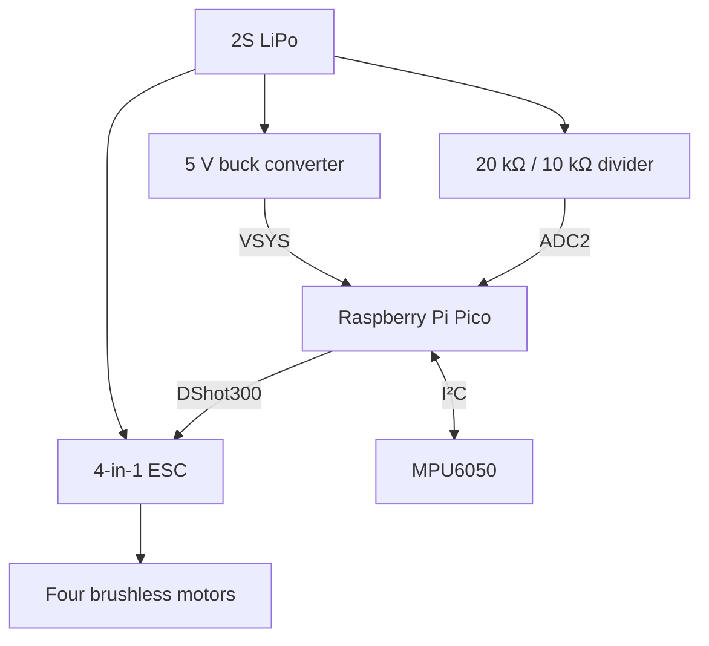

# Drone

A scratch-built quadcopter with a Raspberry Pi Pico flight controller. It runs a short scripted takeoff, hover, and landing using an MPU6050 for motion sensing, per-axis Kalman filters for roll and pitch, and DShot300 for motor control.

## What it does today

The firmware supplies its own setpoints. The [flight plan](flight_plan.c) spools up the motors, commands a climb, holds a zero vertical-speed setpoint for one second, and commands a descent. During flight the controller keeps roll and pitch near level and targets zero yaw rate. Vertical speed comes from integrating gravity-compensated IMU acceleration, so the estimate can drift.

## How it works


- [Attitude estimation](attitude.c) fuses accelerometer tilt and gyro rates using separate [Kalman filters](kalman.c) for roll and pitch. Yaw control uses the measured gyro rate.
- The [500 Hz control loop](flight_controller.c) combines attitude corrections with a climb-rate controller. The [flight plan](flight_plan.c) scales baseline hover throttle using the resting battery voltage.
- The [motor mixer](mixer.c) maps throttle and corrections onto the four motors in a plus configuration. The second RP2040 core streams the latest commands at 2 kHz using [PIO](dshot_tx.pio) and the [DShot300 driver](motor.c).
- The [failsafe](failsafe.c) stops the motors and makes the RAM flight log available over USB. The controller invokes it after landing, on excessive tilt, or after repeated IMU read failures.

## Hardware and wiring

| Qty | Part |
| --- | --- |
| 1 | Raspberry Pi Pico (RP2040) |
| 1 | MPU6050 on a GY-521 breakout |
| 1 | AERO SELFIE 30A 4-in-1 DShot ESC, no BEC |
| 4 | 1103 11000 KV brushless motors |
| 1 | 2S 300 mAh LiPo (7.4 V nominal, 8.4 V full) |
| 1 | LM2596 buck converter set to 5 V |
| 1 each | 20 kΩ and 10 kΩ resistors for battery sensing |

| Connection | Pico | Other end |
| --- | --- | --- |
| 5 V supply | VSYS (pin 39) | Buck OUT+ |
| Supply and IMU ground | GND (pin 38) | Buck OUT− and GY-521 GND |
| IMU power | 3V3 OUT (pin 36) | GY-521 VCC |
| IMU I²C data | GP26 (pin 31) | GY-521 SDA |
| IMU I²C clock | GP27 (pin 32) | GY-521 SCL |
| ESC channel 1 | GP0 (pin 1) | Signal 1, motor −X on 1A/1B/1C |
| ESC channel 2 | GP1 (pin 2) | Signal 2, motor +Y on 2A/2B/2C |
| ESC channel 3 | GP2 (pin 4) | Signal 3, motor −Y on 3A/3B/3C |
| ESC channel 4 | GP3 (pin 5) | Signal 4, motor +X on 4A/4B/4C |
| Battery sense | GP28 / ADC2 (pin 34) | Divider midpoint |
| Divider ground | AGND (pin 35) | 10 kΩ resistor ground end |



Connect the battery, ESC, buck converter, Pico, IMU, and divider to a common ground. Set the buck converter to 5 V before connecting VSYS. Leave the ESC signal connector’s `+` (pack voltage) and `C` (current sense) pins open. The 20 kΩ resistor goes from BAT+ to GP28 and the 10 kΩ resistor goes from GP28 to ground. At 8.4 V pack voltage, the divider puts 2.8 V on GP28. The MPU6050 uses I²C address `0x68`.

## Build, flash, and test

Install the Arm embedded GCC toolchain, CMake, Ninja, and the Pico SDK with its submodules. The [CMake configuration](CMakeLists.txt) selects the original Raspberry Pi Pico and specifies Pico SDK 2.2.0 for the VS Code extension. Set `PICO_SDK_PATH` to your SDK root and put CMake, Ninja, and the Arm toolchain on your PATH.

```console
cmake -S . -B build -G Ninja
cmake --build build
```

**The default firmware arms and starts the scripted flight automatically after initialization. Remove the propellers before flashing or bench testing.**

Hold **BOOTSEL** while connecting the Pico over USB, then copy `build/drone.uf2` to the mounted drive. With the Pico VS Code extension configured, **Compile Project** builds the configured project, **Run Project** uses `picotool`, and **Flash** uses OpenOCD with a debug probe.

Set a flag in [`main.c`](main.c) to `1`, then rebuild and flash. The modes below are listed in priority order.

| Flag | Behavior |
| --- | --- |
| `RUN_BATTERY_TEST` | Prints pack voltage over USB with the motors disarmed. |
| `RUN_IMU_CAL` | Prints level mounting offsets over USB with the motors disarmed. |
| `RUN_MOTOR_TEST` | Arms the ESC, spins individual motors and then motor pairs, and logs IMU rates. |
| All flags set to `0` | Arms the ESC and runs the scripted flight. |

## Download a flight log

Once the run ends, connect the Pico to your computer over USB and run these commands.

```console
python -m pip install pyserial
python download_flight_log.py
```

The script detects a single attached Pico automatically. If needed, pass the serial port explicitly, for example `python download_flight_log.py COM5`. Keep the Pico powered until the download finishes. The log lives in RAM and a reset clears it.

The script writes `flight logs/flight_log_X.csv`. Plot `throttle` and `vz` against `t_ms` to see the flight phases. Plot `roll`, `pitch`, and the corresponding controller corrections to inspect stabilization. Use `vbat` to see battery voltage under load.
