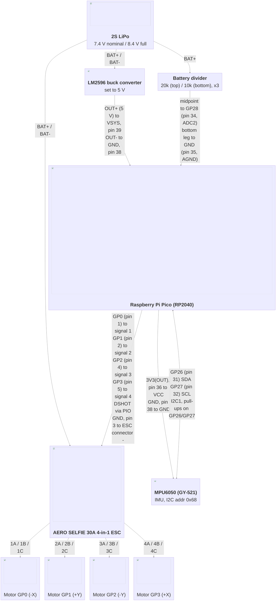

**Project Overview**

This repository contains a small flight-control program for the Raspberry Pi Pico (RP2040). It reads an IMU (MPU6050), runs a simple flight-control loop, and drives motor outputs (PWM). It's intended as a hobby / learning project.

**Prerequisites**

- **Toolchain**: `arm-none-eabi-gcc` (ARM embedded toolchain)
- **Build tools**: `cmake`, `ninja`
- **Pico SDK**: either installed locally or available via `PICO_SDK_PATH` (see project `CMakeLists.txt`)
- **Flashing tools**: use the Pico UF2 bootloader (drag-and-drop) or the included VS Code tasks which call `picotool` / `openocd`.

**Quick Build (cmd.exe)**

1. Create and configure the build directory:

```
cmake -S . -B build -G Ninja -DPICO_SDK_PATH="%USERPROFILE%\\.pico-sdk\\pico-sdk"
```

2. Build the firmware:

```
ninja -C build
```

Alternatively, use the provided VS Code tasks: `Compile Project` builds with the project `build` directory.

**Flash / Run**

- Using UF2: put the Pico into BOOTSEL mode and copy `build\drone.uf2` to the mounted drive.
- Using the provided tasks: run the `Run Project` or `Flash` tasks in VS Code (they call `picotool` and `openocd` respectively).

**Hardware**

- 1 x 7.6v 2S LiPo Power Supply
- 1 x RP2040 (MCU)
- 1 x MPU6050 (IMU)
TODO

**Wiring**



Notes:

- All grounds (battery, ESC, buck, Pico, IMU, divider) are common.
- The ESC `+` pin on its signal connector is battery voltage and is left unconnected, as is the current-sense pin `C`; the ESC has no BEC.
- Motor GPn uses ESC channel n+1 for both signal and outputs: GP0 to signal 1 and 1A-1C, through GP3 to signal 4 and 4A-4C.
- Set the buck converter to 5 V before connecting it to VSYS.
- The battery divider is 20k from BAT+ to GP28 and 10k from GP28 to GND (x3 ratio), which keeps GP28 at or below 2.8 V on a full 8.4 V pack.

**Source Layout**

- `main.c` — entry point: system init, ESC arming, selects flight controller, motor test (`RUN_MOTOR_TEST`), IMU level calibration (`RUN_IMU_CAL`) or battery voltage test (`RUN_BATTERY_TEST`)
- `flight_controller.c` / `.h` — fixed-rate stabilization loop (roll/pitch level-hold, yaw-rate PIDs)
- `flight_plan.c` / `.h` — scripted flight standing in for an RC link (spool up, climb, hold, descend by climb-rate setpoint), with hover feedforward scaled to battery voltage
- `attitude.c` / `.h` — attitude estimator: IMU sampling, gyro bias calibration, Kalman-filtered roll/pitch
- `mixer.c` / `.h` — + configuration motor mixer and motor layout
- `failsafe.c` / `.h` — stop motors, dump the flight log and halt
- `flight_log.c` / `.h` — fixed-point RAM flight log, dumped as CSV over USB
- `battery.c` / `.h` — 2S pack voltage sensing (ADC, GP28 through a divider)
- `battery_test.c` / `.h` — bench test that prints the battery voltage over USB
- `motor_test.c` / `.h` — per-pair bench motor test that logs IMU rates
- `imu_cal.c` / `.h` — IMU level calibration that prints the mounting offsets for `attitude.c`
- `pid.c` / `.h` — PID controller
- `kalman.c` / `.h` — per-axis Kalman filter
- `motor.c` / `.h` — DSHOT motor output (PIO)
- `dshot_tx.pio` — PIO program for the DSHOT transmitter
- `mpu6050.c` / `mpu6050.h` — IMU driver (I2C)
- `vector_3d.h` — small math helpers for 3D vectors
- `download_flight_log.py` — saves the flight log from the Pico over USB serial to `flight logs/flight_log_X.csv` (needs `pyserial`)
- `CMakeLists.txt` — project build configuration
